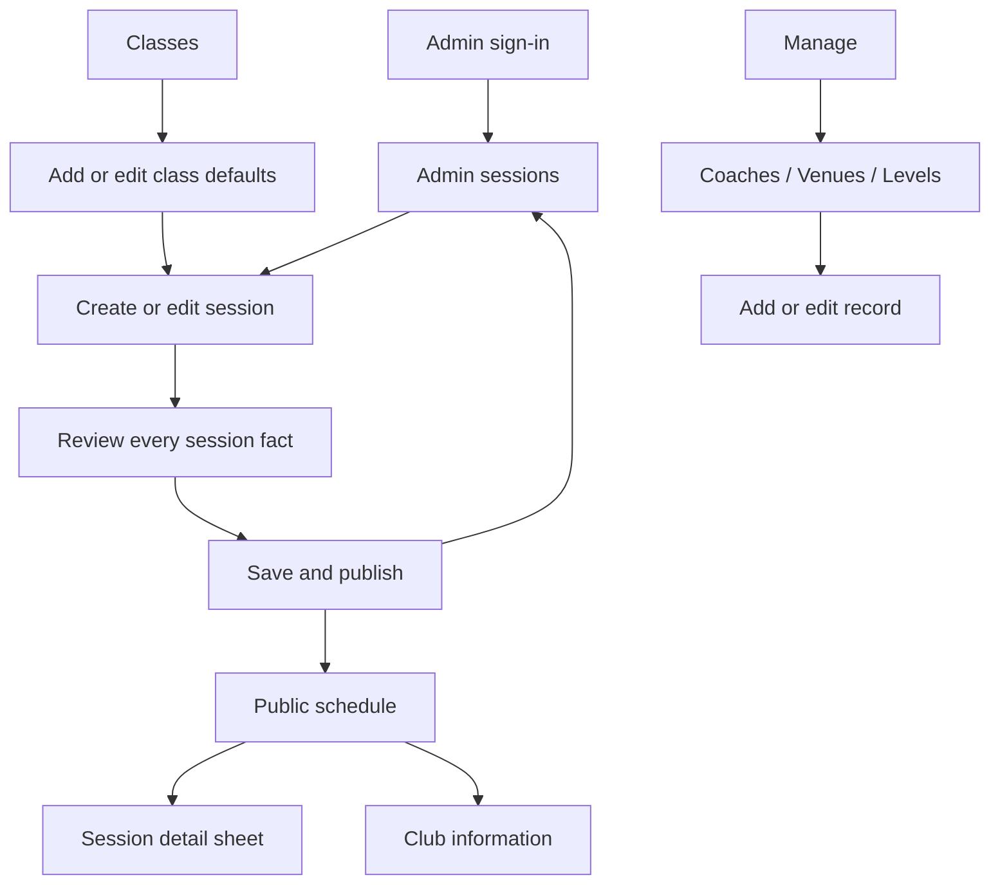

# Phase 1 design blueprint: Publish and Browse Sessions

Date: 2026-10-09
Status: Confirmed by the user on 2026-10-09. Approved design for the remaining Phase 1 workflows. Design confirmation does not establish implementation or runtime acceptance.
Method: Impeccable shape with Antislop core, UI, and mobile-layout checks, during mode. No GSD skill invoked, per the user's instruction.

## Authority and scope

PRODUCT.md and the approved requirements own product truth. 01-SKELETON.md owns the confirmed Phase 1 architecture. DESIGN.md owns the Jalur Lawu visual system. This blueprint extends the existing Phase 1 flows; it does not replace the identity or the operating policies. Existing plans still own implementation tasks, API boundaries, and security checks. Older UI-SPEC visual sections and earlier Community matchday alternatives are historical; their compatible bilingual copy and state rules remain useful.

Reading this as: phone-first public tennis discovery and club operations for members and designated administrators of mixed technical comfort, in Jalur Lawu's Material 3 language, dial ENERGY 2 / RHYTHM 2 / MOTION 2. Mode: Operate for schedule and admin tasks; the club information page serves reading within the same shell.

ENERGY 2 comes from the green signboard and routed time numerals. RHYTHM 2 separates date selection, comparable session rows, grouped details, and focused form steps. MOTION 2 explains selection, sheet opening, and task transitions; it never loops or delays input. Reduced motion applies every change immediately.

## Starting point and intended outcome

Current execution update: all ten plans have implementation summaries. Public details, Manage, class defaults and guided session create/edit are implemented. Build, lint and 137 automated tests pass. Browser/phone acceptance remains pending; see [01-PHASE1-REVIEW.md](01-PHASE1-REVIEW.md).

Existing source now contains every Phase 1 workflow described below. This confirmed screen specification remains the target for manual runtime acceptance.

The completed Phase 1 experience must let an administrator create the reference records, define a class, publish a dated session, edit it safely, and let a signed-out visitor inspect the same facts in either language. A customer can discover a session here; reservation, OTP, rosters, payment, cancellation commands, refunds, and recurrence retain their later-phase ownership.

## Navigation and delivery sequence

The final admin navigation is Sesi / Sessions, Kelas / Classes, Kelola / Manage. Each destination appears only when its route and actions work. During incremental delivery, Sessions is the first destination; Manage follows reference management; Classes follows class management. There are no placeholder booking or payment tabs.

Implementation order: admin sign-in and Sessions (01-04); close schedule/date navigation (01-05); public details (01-07); references and Manage (01-08); classes (01-09); guided session editor, safe editing, and integrated acceptance (01-10). Backup/restore remains the delivered 01-06 capability. Every implemented surface inherits this blueprint and DESIGN.md.

## Screen specifications

| Surface / route | Main question and focal point | Content and action |
|---|---|---|
| Schedule `/` | Which session suits this date? Selected day and start times lead. | Existing date strip, Club Calendar, ordered session rows, states, sample notice. Each row gains a detail action with a name identifying class, time, and state. Preserve date, list position, and day-change behavior. |
| Details, over `/` | What exactly is this session? Time plate and class lead. | Date, start/end with WIB, level, venue and available address, every coach in stored order, IDR price per place, minimum, maximum, exact remaining places, availability and today's timing. Close returns to the invoking row. No booking action in Phase 1. |
| Club `/club` | What is known about Lafu? Supplied club facts lead. | Keep the confirmed text identity and factual list. Missing description/contact/address say unavailable. Real assets may be added when supplied. Do not add a trail illustration or marketing section merely to fill the page. |
| Sign-in `/admin/sign-in` | Can I access club management? Email/password form leads. | One heading, labeled email and password, show/hide password, language action, primary Sign in. Use email and current-password autofill. No customer signup, invitations, or invented recovery service. Returning authenticated admins go to their requested admin destination or Sessions. |
| Sessions `/admin/sessions` | What sessions are on this date, and which needs editing? Date and time-led rows lead. | Today default in WIB, date navigation/picker, time, class, level, venue, price, capacity and state. Explicit Edit session per row; Add session primary action. Successful create/edit shows persistent text by the affected row and makes its date visible. No fake rosters or booking counts. |
| Manage `/admin/manage` | Which club record do I need to maintain? Three labeled destinations lead. | Coaches, Venues, Levels as full-width rows; language and Sign out secondary. No statistics or activity feed. |
| Reference lists `/admin/coaches`, `/admin/venues`, `/admin/levels` | Find or add a named record. Names lead. | Alphabetical records, explicit Edit action, contextual Add action. Venue address is secondary when available. Sample rows remain identified. No delete/archive controls in Phase 1. |
| Reference forms `.../new`, `.../:id/edit` | Save one correct record. Name field leads. | Required name; venue adds optional address. Existing values prefill edit mode. Save returns to the list with persistent success text. Duplicate name is a field error; no duplicate record on retry. |
| Classes `/admin/classes` | Which defaults should a new session inherit? Class name and default facts lead. | Name, level, duration, venue, price, minimum/maximum, every default coach; contextual Add class and Edit class actions. Explain that defaults apply only to new sessions. |
| Class forms `/admin/classes/new`, `/admin/classes/:id/edit` | Define reusable session defaults. Name and grouped fields lead. | Sections: name and level; duration and venue; coaches; price and limits. One page, no arbitrary wizard for this reusable record. Phone sections stack. Save does not alter existing sessions. |
| Session editor `/admin/sessions/new`, `/admin/sessions/:id/edit` | Publish or change one dated session accurately. Current step leads. | Four steps below. Full page, not a nested modal. Step heading receives focus; Back and Continue keep values. Only the final valid save writes session values. |

The admin route names are inherited from the existing plans. A sign-in return path must be a same-origin admin path. Public navigation retains Jadwal / Schedule and Klub / Club; administrative entry can be a small labeled link on the club page once the sign-in route exists, without displacing the public destinations.

## Guided session creation and editing

| Step | Indonesian / English | Fields and behavior |
|---|---|---|
| 1 | Kelas dan waktu / Class and time | Class, club date, start time marked WIB, duration. Selecting a class fills editable defaults. Show calculated end date/time so crossing midnight is understandable. |
| 2 | Level, lokasi, dan pelatih / Level, venue, and coaches | Level, venue, one or more coaches as vertically labeled checkbox rows. Include every selected coach on review in stored order. No coach photos, biography, or contact fields. |
| 3 | Harga dan batas peserta / Price and participant limits | Integer IDR price per place, minimum participants, maximum capacity. Separate minimum from availability; setting a minimum does not enable automatic cancellation. |
| 4 | Periksa sesi / Review session | All facts including every coach and calculated end time. Contextual Edit links return to the corresponding step without loss. Explain immediate publication before the primary save action. |

Step labels read Langkah {n} dari 4 / Step {n} of 4. Actions remain in document flow and reachable with the keyboard open; bottom navigation must not cover them. Save names its operation and prevents repeated presses. Class changes after overrides require explicit confirmation before replacing defaults. Loading an existing session uses its saved values, never newly changed class defaults.

In create mode, retain safe form values and the repeat-safe request ID in sessionStorage, as the existing plan specifies. Clear them after confirmed save or deliberate discard. Edit mode retains local input in memory; it must not pretend to survive reload. Never persist passwords, cookies, or CSRF tokens with a draft. A missing-reference detour saves the create draft before leaving, then reloads current options on return. Language changes do not reset input or steps.

## Forms, boundaries, and conflict recovery

Use visible labels above fields, hints below, errors adjacent and announced. Validate on Continue/Save, or a field's blur after interaction; do not mark untouched empty fields invalid at first paint. Focus the first invalid field; server errors on a prior step return the user to that step. Numeric keyboards aid entry but never replace integer validation.

Current session limits: duration 15-720 minutes; integer IDR price 0-100,000,000; minimum and maximum 1-500, with minimum not exceeding maximum; at least one distinct coach; real level/venue/class references; new dates from club today through 365 days; today's new start must be in the future. These are existing validation boundaries, not new price or attendance policies. Do not introduce a stricter UI-only rule. Reference name and optional venue-address lengths follow planned 120/300-character rules; confirm against the implemented shared validators when those land.

All updates carry a version. A stale version shows what changed and keeps the admin's local input. On phones show labeled Latest saved and Your changes sections; from 640px comparison can sit side by side. Replacing local values with the latest saved record needs an explicit choice. Never automatically retry an old edit against a fresh version. Deleted or unavailable references remain visible as a correction needed, never silently dropped.

Maximum capacity cannot fall below occupied places. The save must recheck occupancy transactionally, including future Phase 2 reservations; the UI displays the server's corrective error and keeps input. Phase 1's occupancy seam returns zero; do not show synthetic participant attendance as live data.

Unsaved in-app navigation opens a discard confirmation. Tetap mengedit / Keep editing receives initial focus; Buang perubahan / Discard changes is destructive. Browser close/reload uses the browser's native warning, whose exact wording is outside application control. Session expiry returns to sign-in; preserve safe in-memory input where feasible but never claim that an expired save succeeded. Any retained create draft must be associated with the original admin and offered only to that same admin; clear it on explicit sign-out or identity change. This is a privacy requirement for implementation.

## State and bilingual copy contract

| Trigger | Indonesian | English | Recovery |
|---|---|---|---|
| Date has no sessions | Tidak ada sesi pada tanggal ini. | No sessions on this date. | Offer next scheduled date only if API provides one; do not fabricate availability. |
| Entire future window empty | Belum ada jadwal mendatang. | No upcoming schedule yet. | Date browsing and club information remain available. |
| Detail loading | Memuat detail sesi... | Loading session details... | Keep the named sheet open with static placeholders and Close. |
| Detail load failure | Detail sesi belum dapat dimuat. | Session details could not be loaded. | Coba lagi / Try again; close returns to schedule. |
| Session disappeared | Sesi ini tidak tersedia. | This session is unavailable. | Close and refresh the selected date. |
| No admin sessions on date | Belum ada sesi pada tanggal ini. | No sessions on this date yet. | Tambah sesi / Add session. |
| No coaches | Belum ada pelatih. Tambahkan pelatih untuk digunakan pada sesi. | No coaches yet. Add a coach to use in sessions. | Tambah pelatih / Add coach. Equivalent contextual wording for venues and levels. |
| Required references missing | Lengkapi kelas, level, lokasi, dan pelatih sebelum membuat sesi. | Add the required class, level, venue, and coaches before creating a session. | Link to the relevant working management destination; retain create draft. |
| Sign-in invalid | Email atau kata sandi tidak cocok. | Email or password does not match. | Preserve email, clear password; no account enumeration. |
| Sign-in throttled | Terlalu banyak percobaan. Coba lagi dalam {time}. | Too many attempts. Try again in {time}. | Use server retry timing; permit password correction, block early submission. |
| Signed-out admin route | Masuk sebagai admin untuk mengelola jadwal. | Sign in as an admin to manage the schedule. | Sign-in action with safe return path. Private content never flashes. |
| Session save pending | Menyimpan sesi... | Saving session... | Save disabled; values remain visible; no spinner. |
| Save response interrupted | Penyimpanan belum dapat dipastikan. Isian tetap tersedia. Coba simpan lagi. | The save could not be confirmed. Your entries are preserved. Try saving again. | Reuse request ID for create; resolve version for edit. Do not assert that a server commit never happened. |
| Create success | Sesi tersimpan dan tampil di jadwal. | Session saved and visible in the schedule. | Persistent text beside saved row. |
| Class defaults hint | Perubahan nilai awal hanya berlaku untuk sesi baru. Sesi yang sudah ada tetap sama. | Default changes apply only to new sessions. Existing sessions stay unchanged. | Present before save, not only afterward. |
| Edit conflict | Data ini telah diubah oleh admin lain. Periksa versi terbaru sebelum menyimpan. | Another admin changed this record. Review the latest version before saving. | Lihat versi terbaru / Review latest version; keep local entries until explicit replacement. |
| Capacity conflict | Kapasitas tidak boleh kurang dari {count} tempat yang telah terisi. | Capacity cannot be below {count} occupied places. | Associate with maximum field; keep values and return to limits step. |
| Discard | Buang perubahan? Perubahan yang belum disimpan akan hilang. | Discard changes? Unsaved changes will be lost. | Keep editing initially focused; discard only on explicit action. |

Display Open, Nearly full, Full, Cancelled, Next, In progress, and Ended as words in both languages. Nearly full uses positive remaining/max <= 0.25 exactly. Cancelled takes precedence; Full carries no redundant zero count. An ended session has no availability claim in its summary, but its details can show historical capacity facts without a booking invitation. Remaining places are factual counts, never a minimum-participant progress bar.

Every surface covers empty, loading, failure, populated, partial, long-text, zero/one/many where applicable. Load failure is never presented as an empty list. Saving preserves values and error context. Static local dialogs have no invented server-loading state. Named sample records and sample notices remain visible in any development list or detail that includes them.

## Responsive and accessible composition

- 320-639px: one column; existing 16px gutters and safe areas; state cell under session facts; bottom navigation. Forms use full-width fields, stacked actions when labels need space, minimum 48px targets, 8px gaps for independent controls. Sheet has 28px upper corners, a named Close control, internal scrolling, and at most the available dynamic viewport height. Drag is optional, never the only dismissal method.
- 640-1023px: 80px navigation rail, 24px gutters, wider facts/state rows. Admin forms remain a comfortably readable single column; related short numeric fields may pair only when labels and errors fit. Public details use a centered dialog capped around 40rem. No horizontal table is required.
- 1024px and wider: 32px gutters; public schedule may use the existing two-column list. Admin sessions remain a chronological list aligned by time; manage/reference content stays compact. Editors cap reading width around 48rem; review and conflict comparison may use two columns. Do not turn extra space into metric cards.
- At 200% zoom, use the effective viewport layout and wrap every name, error, translated label, and action. Do not truncate required session facts. Loading placeholders approximate the actual composition without shimmer or pulse.
- Modal sheet/dialog traps focus, names its title and description, makes background content inert, closes via Escape and its visible Close control, and restores focus to the trigger. If the trigger disappeared after refresh, focus the selected date heading. No stacked form dialogs.
- Keyboard users can reach date controls, sessions, each coach choice, review edits, recovery actions, and sign-out. Visible 2px focus follows DESIGN.md, white on signboard. Color and icon marks supplement words. No action requires hover, swipe, haptics, or animation.
- Test soft keyboard reachability on a physical phone, top/bottom safe areas, landscape and short-height screens. Footer actions stay in flow; decorative header content may compact before usable form space is lost.

Signature elements retain their purpose: sage post plates anchor time comparison; green marks selection and the primary action; tonal surfaces group related facts; shadows indicate overlays. Material buttons can be round because fields, plates, panels, and sheets use distinct role-specific shapes. Icons name real actions or facts; no decorative dots, emoji, invented statistics, feeds, or testimonials.

## Content still required from the club

Provide the Indonesian/English club description, address and contact details; real coaches, venues and levels; actual classes, session times, prices, and participant limits; logo and optional approved photography. Club contact or mapping actions appear only with real destinations. Keep the text LAFU icon/identity until a logo is supplied. No illustration, attendance claim, or realistic-looking fictitious record is authorized by this blueprint.

Do not prevent technical development on missing assets: labeled development records and explicit unavailable states support it. Production readiness still requires the club's real content review. Operational verification also includes the existing hidden-password terminal prompt and backup/restore procedure; design cannot establish those passed.

## Acceptance evidence and finish boundary

The original design pass produced this reviewable blueprint. Subsequent implementation completed all ten source plans; fresh evidence is in 01-PHASE1-REVIEW.md. Neither design confirmation nor passing non-browser checks awards an Antislop runtime PASS, marks requirements accepted or closes manual WINDOWS items.

| Evidence | Required scenario | Current status |
|---|---|---|
| Automated logic/API/database | Date boundaries, exact availability, authorization, validated publication, retries, safe edits, class-default isolation, persistence and restore | Fresh full suite: 137 tests pass, including new reference/class/update/detail cases; build and lint pass. |
| Desktop and mobile inspection | Batch 320, 390, 640, 820, 1024, 1440 widths; ID and EN; light and dark; loading, error, empty, long text, keyboard/focus, zoom | Pending. Existing screenshots are references and contain mocked capacity states. |
| End-to-end task | Admin signs in, adds references, creates class, publishes session, edits it; signed-out visitor selects date and verifies every fact and coach in both languages | Pending. |
| Failure/recovery task | Duplicate create retry, stale edit, capacity conflict, missing reference, expired sign-in, unsaved navigation, detail load failure | Pending. |
| Physical phone | Soft keyboard, safe areas, one-handed forms, sheet close/focus, final actions reachable | Manual pending under the standing browser-execution preference. |
| Antislop finish | Core Delivery Gate plus UI and mobile checklists, item-by-item evidence for the running workflows | Pending. Token contrast evidence alone is insufficient. |

For implemented UI, use Impeccable's bounded finish: build fully, inspect once in a batched mobile/desktop round, fix identified problems together, confirm in at most one additional round. Resolve any remaining material defect or record it honestly; do not claim an unfinished workflow accepted. Browser automation remains disabled by the user's standing instruction unless they change it; implementation still needs recorded manual interaction evidence.

## Design review for this pass

PASS: scope stays within the 14 Phase 1 requirements and existing plan flows; all remaining public/admin surfaces are named above.

PASS: every proposed action has a defined destination, mutation, or recovery behavior; destinations appear only with working implementation.

PASS: DESIGN.md supplies palette, typography, shapes, motion, and identity; the dial read and purpose of each signature element are explicit.

PASS: responsive, bilingual, state, input-preservation, privacy, and conflict requirements are specified, including intermediate widths and physical-phone checks.

CONFIRMED: the user approved this blueprint on 2026-10-09.

PENDING: real club content, runtime layout/accessibility, full Delivery Gate, temporary shortcut cleanup after testing, and Phase 1 acceptance. These are not design-check PASS claims.
