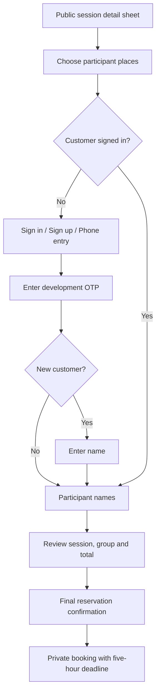

# Phase 2 customer and admin interaction contract

Status: planned, not built. Apply Antislop core/UI/mobile in the established during mode. Mode: Operate. ENERGY 2 / RHYTHM 2 / MOTION 2. Root DESIGN.md owns Jalur Lawu's club signboard, tonal surfaces, system reading face, Barlow Condensed sign numerals and device-following themes. UI UX Pro Max guidance from the prior polish continues: one primary action, clear parent navigation, paired step actions, visible labels, short purposeful motion and reduced-motion support. No new visual direction or asset generation is needed.

## Customer flow

No step before final confirmation holds capacity. The quantity screen states this directly. Recheck availability after sign-in and on review. A changed session/price or insufficient capacity returns the customer to explicit review with values preserved; never reduce the group silently or show reservation success before the API commits.

Public details retain their existing sheet. Book routes to `/book/:sessionId` with a validated return-date context. Booking is a full page so the phone keyboard and participant list have room. Signing in from booking preserves session, quantity and names. Customer access also has a dedicated `/customer/sign-in` path; sign-in/sign-up/phone-entry choices explain the same OTP mechanism without adding a password form. New verified phones complete one name field; existing customers proceed directly.

Phone entry uses a labeled telephone field, Indonesia default and explicit international support. OTP is one paste-friendly six-digit field with `autocomplete=one-time-code`, numeric keyboard, resend countdown and Edit phone. Resend/error/expiry retains the chosen session and quantity. Development-only notice identifies a test code returned by the API; a labeled development code can be displayed for easy manual testing, but it is never auto-verified. Production cannot render this notice/code.

Participant defaults use the verified booker's name followed by numbered guests. Each participant has a visible ordinal and editable name. For large groups use a paged name editor (ten at a time) with named ranges and Previous/Next; final review still accounts for every place and flags incomplete names. This is a presentation boundary, not a ten-person booking limit. All names remain in the parent draft; final server admission validates the entire group.

Review shows date/WIB start/end, class/level/venue/coaches, quantity, every name, unit price and exact total. Show the five-hour rule and booking cutoff as words. The filled final action is **Konfirmasi reservasi / Confirm reservation**. Pending becomes **Menyimpan reservasi... / Saving reservation...** and blocks duplicates. A lost response retries the original UUID and can recover the same booking, including an expired result, without a new hold.

## Private booking views

Working routes: `/bookings` and `/bookings/:id`. Add a customer Bookings destination only when it is implemented; existing Schedule and Club remain. Signed-out Bookings prompts customer sign-in and returns to the same private path after verification. Customer auth never grants admin access.

List rows show session date/time, booked places, total and text status, with a clear path to details. Upcoming and History views retain expired bookings so failure is explainable. Details show all participant names, original absolute deadline in WIB, remaining time synchronized to server time, and the session snapshot. A local countdown reaching zero refreshes status; it does not authorize an expiry write.

Phase 2 delivers awaiting-payment and expired outcomes. Payment submission and confirmation commands are Phase 3. No dead Pay/upload button or false confirmed state. Where payment is not available, use **Pembayaran belum tersedia / Payments are unavailable** with existing club contact/help when supplied. Development reservations are explicitly test data, and production booking access remains gated until real OTP is ready.

Customer sign-out clears private data and owner-bound drafts. Reauthentication as the same customer preserves the in-memory task; another identity clears it. Persist only selected public session/quantity before authentication. Authenticated participant drafts may use owner-scoped sessionStorage, never localStorage; no OTP, debug code, cookie token or CSRF token is persisted there. Different identity, successful reservation or deliberate discard clears the authenticated draft.

## Admin flow

Sessions remains the primary dated operational surface. Add one **Peserta / Participants** action per session to `/admin/sessions/:id/roster`, with counts expressed as occupied participant places and remaining places. Keep Edit session separate and accessible. Roster has a clear parent return, factual session summary and grouped booker/participant rows; one group of four remains one booking with four places.

Add a working Bookings destination to existing Sessions/Classes/Manage (four destinations total). `/admin/bookings` shows incoming bookings in stable order with date/status filters. `/admin/bookings/:id` shows participants, contact phone/name, verified-owner status, original deadline, unit/total and reservation state. Private contacts never appear in public session sheets.

**Tambah reservasi / Add reservation** from a roster opens `/admin/sessions/:id/bookings/new`, preselecting that session. Steps: customer name/phone, quantity and participants, full review and confirm. Participant defaults use the entered booker name. It uses exactly the same capacity/cutoff/hold behavior as customer booking. No paid checkbox, cancellation, moving or manual payment recording in this phase.

On an unowned booking, an admin can find the customer using the exact contact phone, then review a verified matching identity and choose **Hubungkan akun / Link account**. Explain that this grants the customer's access to the booking. Missing verification, mismatch, already-owned or stale-version cases have explicit recovery and no automatic link. Linking retains all booking facts and the original deadline. Lost-number recovery shows club-assistance guidance rather than a self-service transfer.

## Shared layout, actions and motion

- Parent-list return appears above the task. Previous/Continue or Previous/Confirm share one phone action row, secondary left and primary right. At wider widths align the pair right. Do not stack two Back actions plus Continue.
- Reuse current date/time pickers, Radix fields/sheets/dialogs and Motion. New booking flows use the same 200ms directional step feedback, menu-origin opening, short check feedback and 120ms exits; no loops, background motion or blocked taps.
- One column at 320-639px. From 640px use paired short fields and the existing rail; large participant sets remain readable lists. From 1024px review can place factual summary beside names without changing order or adding dashboard cards.
- 48px field/action/label targets, 8px gaps, wrapping labels, min-width-zero grids, clear focus, bottom-nav content clearance and safe-area gutters. Keep final actions in document flow so the phone keyboard cannot hide them under a fixed footer.
- Focus the new step heading; field errors move focus to the first affected field. Dialog close restores the trigger. Preserve language and date context on Back. Reduced motion applies state changes immediately.
- Every new surface has named loading, empty, error/retry, expired-auth and long-content states in ID/EN. Capacity and status always have text; color only echoes it.

## Validation boundary

This is a design contract, not a UI PASS. No Phase 2 screenshots or runtime tests exist. Build/source checks, privacy/capacity integration tests and the Antislop Delivery Gate are required during implementation. Browser automation remains disabled by user preference; record manual task evidence without inventing devices, measurements or screenshot review.
