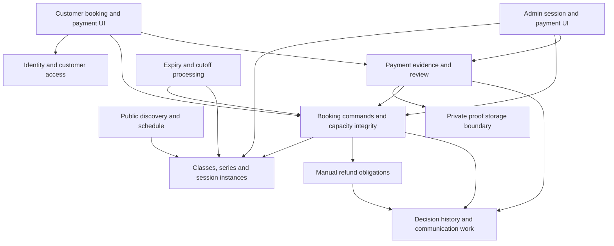
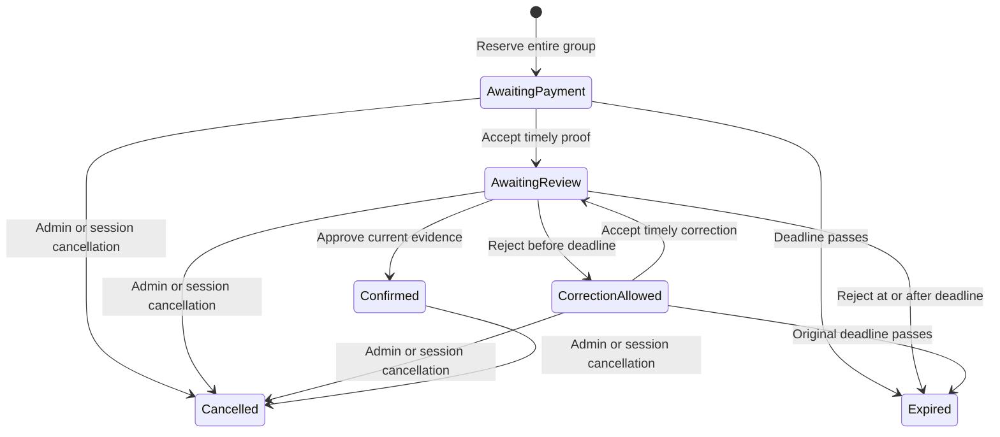

# Architecture Research

**Project:** Tennis Club Booking for Lawu Fun Tennis Club / Lafu
**Domain:** Mobile-first tennis coaching reservations and manual payment operations
**Researched:** 2026-10-07
**Confidence:** MEDIUM for advisory architecture; unresolved club policies are explicitly open

## Scope and evidence

This document recommends responsibilities, state interactions, integrity guarantees, and build dependencies. Frameworks, database, API contracts, infrastructure, vendors, and physical schemas remain separate decisions. PostgreSQL, AWS, Twilio, and Stripe documentation provides examples of relevant guarantees, not a commitment to those products. The React/TypeScript/Vite starter is existing context.

Business rules come from `.planning/PROJECT.md` and the confirmed bilingual Indonesian/English direction. External documentation validates technical mechanisms, not club policies. Recommendations below are design inferences that must be checked against the eventual implementation.

The project-scoped research seam selected `websearch`; `classify-confidence --provider websearch --verified` returned MEDIUM. TinyFish supplied search and document retrieval because that toolkit is available. The installed classifier does not recognize TinyFish and returned LOW for that transport, so its project-local cache entries retain LOW. This limitation is recorded rather than treating cached transport scores as evidence of vendor guarantees. Eight official primary pages were read and critical concurrency reasoning was cross-checked between isolation/locking documentation and repeat-delivery documentation. No claim receives HIGH confidence here.

## Recommended responsibility boundaries

Use cohesive business modules behind one authoritative booking workflow. Customer and admin actions should call the same reservation and payment rules. Boundaries describe ownership and can initially live together; they do not imply separately deployed services.

| Responsibility | Owns | Required interactions |
|---|---|---|
| Public discovery and schedule views | Club information, date navigation, localized session details and availability presentation | Reads public session information; exposes no customer names, phone numbers, or proof |
| Identity and customer access | Verified external identity mapping, stable local customer, customer ownership and admin permissions | Gives trusted actor identity to commands; phone delivery channel remains replaceable |
| Classes, series, and session instances | Class defaults, recurring templates, independent occurrences, venue, assigned coaches, level, prices, min/max places, cancellation configuration | Supplies a specific session to booking; controls whether it accepts reservations |
| Booking and capacity | Group participant places, fixed reservation deadline, active allocation, confirmation, expiry, admin moves/cancellation | Coordinates every capacity-changing action with session state |
| Payment evidence and review | Instructions, submitted proof versions, rejection reasons, approval, outside-payment evidence | Changes booking state through guarded commands; proof is evidence awaiting a human decision |
| Private proof storage boundary | Authorized upload/read, validation, stable evidence version, cleanup/retention | Accepts only evidence associated with an authorized booking; exposes limited access to reviewers |
| Refund obligations | Due/completed refund tracking and manual completion evidence | Receives paid cancellation decisions; completing a refund never reactivates places |
| Time-driven processing | Unpaid expiry, optional minimum-attendance checks, overdue reconciliation | Calls the same business transitions as interactive actions; tolerates duplicate and late execution |
| Decision history and communication work | Actor, reason, prior/resulting state, evidence version, failed downstream work | Records committed decisions; delivers notices after authoritative changes |

## Core integrity model

### Count places, not bookings

One booking can reserve several participant places. Every named place counts once toward maximum capacity and the minimum to run. Numbered guest names are editable display data; a guest need not become an authenticated customer. The booker owns the group booking.

Define one shared active-place predicate for reservation checks, schedule availability, participant lists, and minimum-attendance evaluation:

- Confirmed places count while their booking and session are active.
- Awaiting-payment places count only while the original five-hour deadline remains valid.
- Places awaiting review of accepted submitted proof count even after that deadline.
- Rejected-proof places count only during the remainder of the original deadline.
- Expired or cancelled bookings contribute no active places. A cancelled session accepts no new bookings.

`occupiedPlaces(session, decisionTime)` is the sum of participant quantities satisfying that predicate. Remaining places are maximum minus occupied places. Admission must ensure existing occupied places plus the complete requested group quantity does not exceed maximum. Displayed availability is informative; the successful authoritative reservation decides whether a group obtained places.

**Recommendation:** Make current effective expiry part of this predicate so a delayed expiry worker cannot leave abandoned bookings counting indefinitely. Persist explicit expiry transitions for customer history and operational views, and reconcile any materialized totals with the same predicate. Count proof-awaiting-review independently from the deadline.

### Reserve groups atomically

All group places succeed together or none are allocated. Read current session eligibility and occupied places, evaluate the request, and commit its entire allocation inside one protected consistency boundary. Customer reservations, admin reservations, expiry, proof rejection, moves, capacity edits, and cancellation must participate in that boundary.

**Recommendation:** Protect a stable per-session authority before counting active allocations. The eventual persistence choice must supply an equivalent guarantee, such as a common lock boundary, an atomic conditional allocation, or serializable transactions with complete retries. Locking only existing booking records leaves competing new bookings outside that protection. Plain read-then-insert transactions can still admit competing groups based on stale counts. PostgreSQL documents both serialization anomalies and row-lock exclusion; its mechanisms illustrate the guarantee needed here. [Transaction isolation](https://www.postgresql.org/docs/current/transaction-iso.html), [explicit locking](https://www.postgresql.org/docs/current/explicit-locking.html).

Repeat a submitted command safely using a stable operation identity scoped to the actor and intent. Retried taps must return the original outcome rather than create another booking. Reject reuse with different participant quantity or session. Do not hold the consistency boundary while waiting for OTP, an upload, a notification, or human review.

For an admin move, validate destination eligibility/capacity and transfer the entire allocation consistently with source release. If destination admission fails, preserve the source allocation. A common ordering of source/destination coordination reduces deadlock risk. Moving a paid booking also needs explicit price-difference policy; this research does not select it.

Reducing capacity below active allocations must not silently create negative availability. Recommend rejecting the edit until the admin resolves affected bookings; an override/remediation workflow remains a product decision.

## Booking, evidence, and deadline interactions

Maintain distinguishable booking allocation, payment evidence, and refund obligation concepts. A rejected image does not prove that money never arrived. A cancelled booking can still require refund work.

The following labels describe business states, not prescribed enum names or a database model:

| Current situation | Event and guard | Result | Places |
|---|---|---|---|
| New booking | Whole group fits an eligible session | Awaiting payment; original deadline fixed at reservation time plus five hours | Reserved |
| Awaiting payment | Valid proof submission accepted within the window | Awaiting admin review; deadline unchanged | Reserved through review |
| Awaiting payment | Deadline passes without accepted proof | Expired | Released |
| Awaiting review | Admin approves the current evidence on an active session/booking | Confirmed with recorded payment decision | Already reserved; do not allocate again |
| Awaiting review | Admin rejects before original deadline | Correction allowed until that same deadline | Reserved until deadline |
| Awaiting review | Admin rejects at/after original deadline | Expired/released with rejection history | Released immediately |
| Correction allowed | Replacement accepted within remaining time | Awaiting review of a new evidence version | Reserved through review |
| Correction allowed | Original deadline passes without accepted replacement | Expired | Released |
| Active booking | Admin cancels or session is cancelled | Cancelled; recorded money is evaluated for refund obligation | Released |
| Cancelled/expired booking | Money received or evidence discovered later | Reconciliation/refund work according to admin decision | Never silently restored |

**Recommendation:** Use authoritative server time for all guards and preserve the original deadline through every proof version and rejection. Adopt a single exact-boundary convention, such as accepting submissions only when decision time is strictly before the deadline, during detailed planning. Client countdowns explain remaining time but cannot decide eligibility.

**Open policy:** Define admission near session start and the latest booking time. A booking created less than five hours before a session may have an unpaid deadline after the session begins; neither shortening that deadline nor allowing attendance on an unpaid hold is established. Decide the allowed booking window, proof-review/attendance treatment near start, and any admin exception before implementing session eligibility. Preserve the agreed five-hour window unless the user explicitly changes it.

Proof submission is a business transition after durable evidence is associated with the correct booking. Opening an upload picker, obtaining an upload URL, or sending bytes that never finish must not grant an unlimited review hold. Two admins reviewing the same booking must act against the current evidence/state version; the second conflicting decision should refresh rather than overwrite the first.

**Open policy:** Decide what counts as timely submission when an upload finishes before the deadline but required validation/finalization finishes afterward. Decide treatment of uploads already in flight at expiry, tolerated retry failures, and replacement proof while an earlier version awaits review. These choices must preserve the five-hour rule without losing legitimately submitted evidence.

## Scheduled cancellation and race handling

Automatic cancellation is optional. At the configured cutoff, evaluate the eligible participant-place count using current effective booking state. A three-person group contributes three. Awaiting-review proof retains all its places beyond the unpaid deadline and therefore still contributes to the minimum. Confirmation does not add another copy of those places.

**Recommendation:** Perform the eligibility check and session cancellation decision within the same per-session consistency boundary used by reservation admission. Record the cutoff/configuration version evaluated. A delayed or duplicated job must recheck session state, whether automatic cancellation is still enabled, and whether the relevant cutoff remains due. Schedulers may redeliver, as illustrated by AWS's at-least-once guarantee; repeat-safe handlers are necessary. [EventBridge FAQ](https://aws.amazon.com/eventbridge/faqs/).

| Concurrent actions | Required outcome |
|---|---|
| New reservation versus cutoff check | Both see one consistent decision order; a cancelled session cannot accept a later reservation |
| Expiry versus proof submission | Exactly one guarded transition applies according to the agreed submission boundary; timely awaiting-review places survive ordinary expiry |
| Rejection versus cutoff check | The effective active-place predicate and committed decision order determine whether rejected places still contribute |
| Approval versus session cancellation | Approval cannot resurrect a cancelled session; accepted money discovered after cancellation goes to reconciliation/refund handling |
| Cutoff job versus changed cutoff | An obsolete job does not apply an outdated rule; evaluate the current configuration/version |
| Repeated expiry/cancellation/refund command | No repeated seat release, second refund obligation, or duplicate completion |

Make the session closed to admission as part of its authoritative cancellation decision. Any later fan-out to individual booking views, refund work, and notices must preserve this fact; partial fan-out cannot keep some bookings bookable. Retain enough durable work tracking to recover after interruption without repeating financial effects.

**Open policy:** Is the minimum checked once, periodically, or again after later rejection/expiry? A session that meets the minimum at cutoff can lose pending-payment places afterward. Also settle cutoff scope, absolute versus relative configuration, timezone, cutoff changes after evaluation, and reopening a cancelled session. No automatic post-cutoff re-evaluation or reopening is implied here.

## Recurring series and independent sessions

**Recommendation:** Treat recurrence as a way to generate bookable session instances. Each instance owns its own date/time, coaches, venue, price, min/max, bookings, cutoff, and operational status. Preserve stable occurrence identity when its time changes. Keep the relationship to its source series so the admin can understand and target edit scope.

RFC 5545 distinguishes a recurring set from a particular occurrence through `RECURRENCE-ID`, including the case where an occurrence moves to another time. This supports independent occurrence identity; it does not prescribe the application's persistence model. [RFC 5545 section 3.8.4.4](https://datatracker.ietf.org/doc/html/rfc5545#section-3.8.4.4).

Generation should be bounded to an explicit booking horizon and repeat-safe so rerunning it creates no duplicate session. Established bookings and reviewed payment amounts need stable historical context even when class defaults change. Begin with independent sessions, then add recurrence once edits and cancellation work on a single occurrence.

**Open policy:** Edit this occurrence, future unbooked occurrences, all future occurrences, or the whole series? What happens to existing bookings, prices, coaches, moved occurrences, and exceptions? Decide the actual club/session timezone and preserve timezone semantics when deriving recurrence and cutoff instants. Bilingual date formatting and the developer machine's Asia/Bangkok setting do not determine the club timezone. RFC 5545 distinguishes timezone-bound time from floating time. [RFC 5545 section 3.2.19](https://datatracker.ietf.org/doc/html/rfc5545#section-3.2.19).

## Identity and access responsibilities

**Recommendation:** Verify OTP server-side with the selected provider, then resolve or create a stable local customer and complete required name entry. Separate OTP delivery from ownership of customer/bookings. Normalize phone numbers consistently and make concurrent first-login creation safe. Twilio's verification-check documentation distinguishes approved from pending/failed checks and requires E.164 phone formatting; it is an example of the provider-result contract to verify. [Verification Check](https://www.twilio.com/docs/verify/api/verification-check).

Admin-created bookings must refer to the intended customer, while recording the admin as the acting operator. Participant names are neither login identifiers nor authorization evidence. A customer accesses only their bookings/proof; admin authority is an explicit permission, not a phone-number match. Public schedule output must omit private operational fields.

**Open policy:** Define how verified self-service identities claim an admin-created customer record, how another sign-in method links to the same customer, and how phone changes, recycled numbers, disputed ownership, or duplicate customer records are handled. Do not auto-merge existing accounts based on an unverified profile phone. OTP verification establishes current phone possession, so recovery/linking safeguards remain a separate design task. Provider, primary sign-in method, SMS/WhatsApp choice and fallback behavior remain undecided.

## Payment proofs, manual decisions, and refunds

Use private evidence storage with per-booking upload/read authorization, generated object identifiers, content validation and agreed file limits. OWASP recommends safe extension/type checks, generated filenames, authorization and storage away from the public webroot. A proof viewer should receive access only after authorization rather than relying on an obscure public URL. [OWASP File Upload Cheat Sheet](https://cheatsheetseries.owasp.org/cheatsheets/File_Upload_Cheat_Sheet.html).

**Recommendation:** Preserve the exact evidence version reviewed and make it resistant to later replacement. Short-lived signed access is one possible mechanism, subject to the selected store's guarantees. AWS documents that presigned URLs are bearer tokens, can be reused until expiry, and may overwrite an object with the same key. Unique upload targets alone are insufficient if the same live URL can still replace accepted evidence; finalization must bind to an immutable version or protected copy. [S3 presigned URLs](https://docs.aws.amazon.com/AmazonS3/latest/userguide/using-presigned-url.html).

Keep credentials and long-lived access outside the browser. Do not put proof URLs or images in public schedule data, general notification text, or ordinary logs. Retention/deletion periods, allowed image/PDF formats, file size and scanning/validation behavior require explicit planning.

Admin approval, rejection, outside-payment recording, booking movement, cancellation, and refund completion should record actor, authoritative time, reason/reference, affected quantity/amount, and relevant evidence. A manual payment record represents the admin's decision that money was received; uploaded proof remains unverified until review. Recording outside payment must coordinate with current booking/session state so it cannot bypass capacity checks.

**Recommendation:** Track money-received evidence separately from refund obligations and their completion. Paid cancellation can create one obligation for the affected payment; completing it records actual manual refund evidence and never calls a booking-confirmation path. If an unreviewed proof belongs to a cancelled booking, flag reconciliation so admins can establish whether money arrived and a refund is due. Do not equate every uploaded image with a completed payment.

**Open policy:** Set refund amount rules for partial group changes, price differences on moves, over/underpayment, rejected proof with actual receipt, and money paid after expiry/cancellation. Actual transfers remain manual.

## Bilingual presentation boundary

**Recommendation:** Keep business state independent of Indonesian/English wording. Both customer and admin screens map the same state to localized labels, explanations, validation messages and notices. Show the deadline and rejection reason consistently across languages. Preserve user-entered participant names, payment references, and audit reasons without automatic translation. Time/currency presentation must use explicit settings once chosen, rather than inferring them from language. Currency and timezone remain open requirements.

## Future payment adapter

Reserve a boundary for payment evidence sources rather than implementing a gateway now. The first version uses manual proof review and recorded outside payments. A later provider adapter should translate verified payment events into guarded business commands that apply the same confirmation, cancellation, reconciliation and refund rules.

Provider event identity and business transition identity are distinct: deduplicate both deliveries and resulting effects. Do not use event arrival order or a customer redirect to decide final payment status. Stripe documents signature verification and duplicate/out-of-order delivery; these are example behaviors to check for the chosen provider later. [Stripe webhooks](https://docs.stripe.com/webhooks).

Late payment for released places creates a reconciliation case, not an unconditional booking confirmation. Implement provider integration only after selecting a provider and deciding late-payment policies. Gateway-driven refunds also require a separate capability; manual refund completion is sufficient initially.

## Build dependencies and verification priorities

| Suggested build slice | Why this order | Acceptance evidence |
|---|---|---|
| Policy and business-state contract | Deadline, effective active-place count and cutoffs affect every workflow | Agreed examples for all payment/deadline branches and explicit unresolved policy decisions |
| Public schedule and independent admin sessions | A specific eligible session is the reservation target | Mobile bilingual date navigation; min/max/coaches/venue shown; private data absent |
| Identity plus atomic group reservation | Establish ownership and trustworthy temporary capacity before taking payment proof | Competing groups cannot overbook; all-or-none quantities; retry produces one booking |
| Manual proof review plus expiry | Customer's five-hour window and admin review hold interact directly | Timely proof survives deadline; rejection uses original deadline; stale reviewer cannot overwrite |
| Admin operational changes plus refunds | Moves/cancellations/outside payments reuse proven integrity paths | Failed move preserves source; cancelled paid group produces correct manual refund work |
| Optional cutoff automation plus recurring series | These multiply state/race cases and depend on independent-session operations | Duplicate/stale jobs safe; cancellation blocks admission; no duplicate generated occurrences |
| Provider payments later | Normalized commands already exist | Signed, duplicate/out-of-order and late events tested against the same business rules |

This is a dependency recommendation, not a committed roadmap or folder structure. Detailed architecture planning should choose the technical implementation after agreeing policy edges.

Focus concurrency verification on competing last-place groups, simultaneous customer/admin reservations, expiry versus proof submission, double review, rejection after deadline, cutoff versus reservation, approval versus cancellation, and destination capacity during moves. Test logical expiry with the scheduler delayed, process interrupted between cancellation and downstream work, and repeated commands. Include unauthorized proof access and upload replacement after review.

## Operational scale and anti-patterns

At club scale, correctness and review throughput are likely to matter before distributed service decomposition. Measure reservation conflicts/retries, overdue unpaid reservations, age of awaiting-review evidence, cutoff-job delay, failed communications and outstanding refund obligations. Set service targets when workload and operational staffing are known.

Avoid separate customer/admin capacity logic; browser-only timers; decrementing an uncoordinated counter; restarting the deadline after rejection; counting each group booking as one person; treating proof upload as confirmed money; rebuilding booked occurrences from a changed series; and provider callbacks that directly mark bookings confirmed. Each bypasses a business invariant described above.

## Sources

All pages accessed 2026-10-07. Search results were used to locate primary material, not as authoritative substitutes for reading it. Vendor pages without publication dates are documented as undated; RFC 5545 is a dated standard.

| Source | Evidence used | Currency and confidence |
|---|---|---|
| [PostgreSQL transaction isolation](https://www.postgresql.org/docs/current/transaction-iso.html) | Isolation anomalies, serializable transactions, complete retry | Current official documentation; fetched metadata reports 2026-08-13; MEDIUM verified web research |
| [PostgreSQL explicit locking](https://www.postgresql.org/docs/current/explicit-locking.html) | Conflicting row locks and transactional scope | Current official documentation; fetched metadata reports 2026-08-13; MEDIUM verified web research |
| [AWS EventBridge FAQs](https://aws.amazon.com/eventbridge/faqs/) | Scheduler delivery repeats and timezone support | Current official FAQ, undated; MEDIUM verified web research |
| [RFC 5545](https://datatracker.ietf.org/doc/html/rfc5545) | Recurrence identity and timezone semantics | September 2009 standard; relevant sections read directly; MEDIUM verified web research |
| [Twilio Verify Verification Check](https://www.twilio.com/docs/verify/api/verification-check) | Approved verification result and E.164 normalization | Current official reference, undated; MEDIUM verified web research |
| [OWASP File Upload Cheat Sheet](https://cheatsheetseries.owasp.org/cheatsheets/File_Upload_Cheat_Sheet.html) | Authorized, validated, private upload handling | Current official guidance, undated; MEDIUM verified web research |
| [AWS S3 presigned URLs](https://docs.aws.amazon.com/AmazonS3/latest/userguide/using-presigned-url.html) | Bearer access, reuse, expiry and replacement behavior | Current official documentation, undated; MEDIUM verified web research |
| [Stripe webhook documentation](https://docs.stripe.com/webhooks) | Authenticated events, duplicates and order independence | Current official documentation, undated; MEDIUM verified web research |

The five-hour window, retained review hold, minimum-count definition, admin-only changes and manual refunds are project requirements rather than claims derived from these external sources. Final schema/API design, job guarantees, identity policies, recurrence propagation, proof-boundary policy, timezone/currency and refund calculation require phase-specific decisions.
